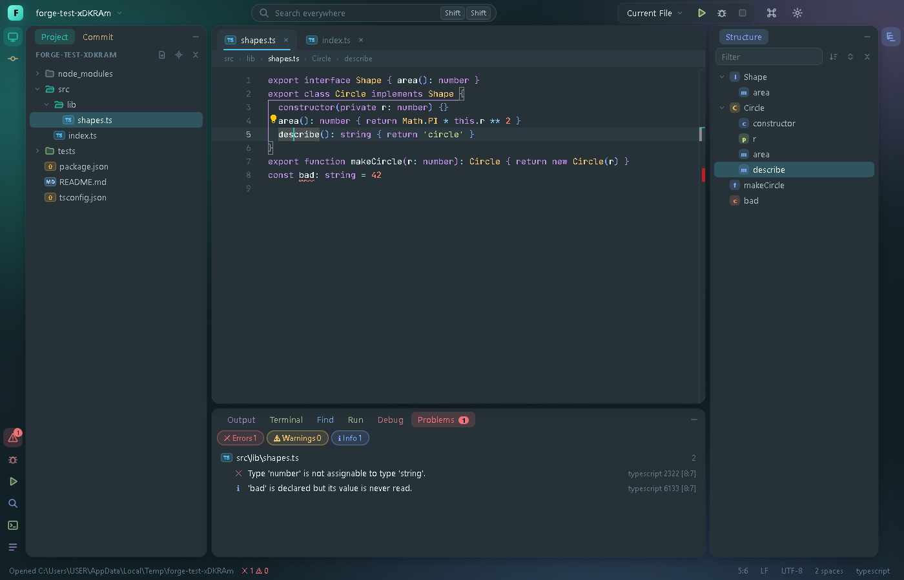
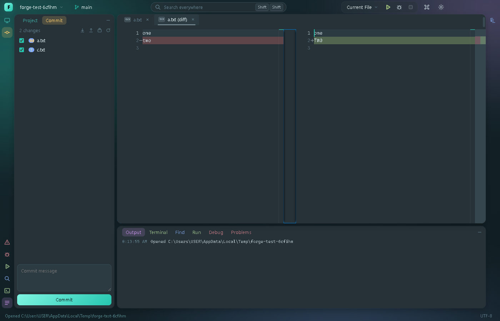
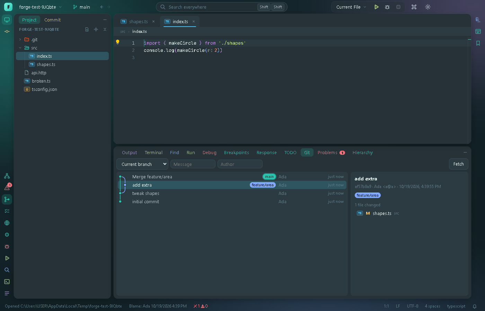
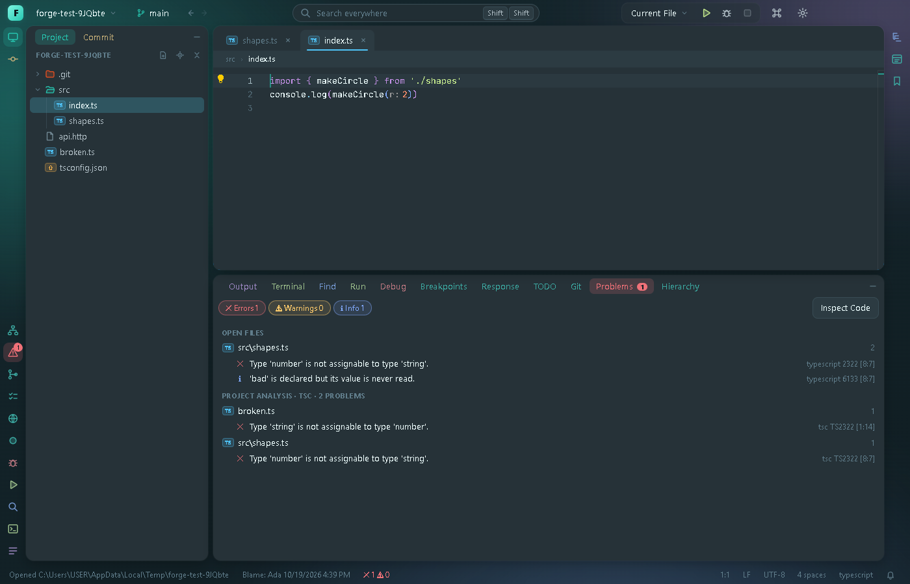
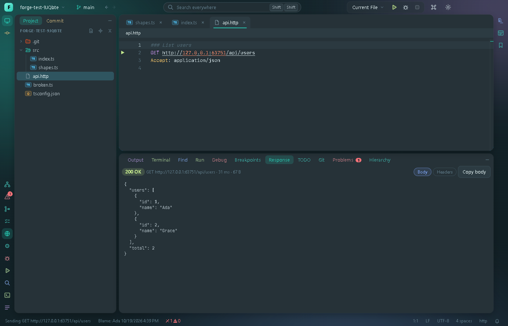
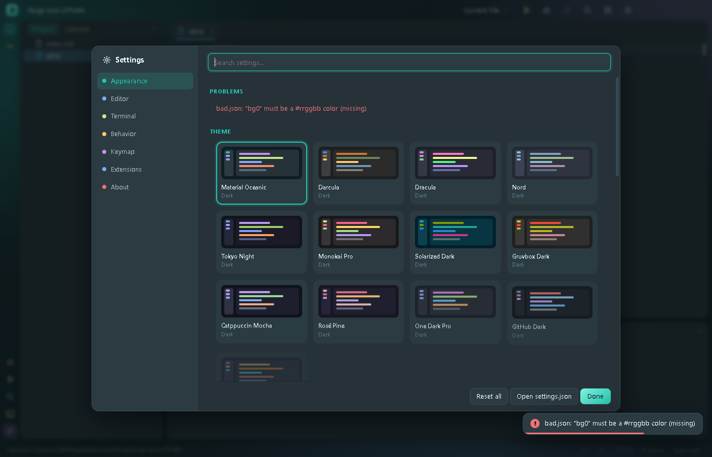
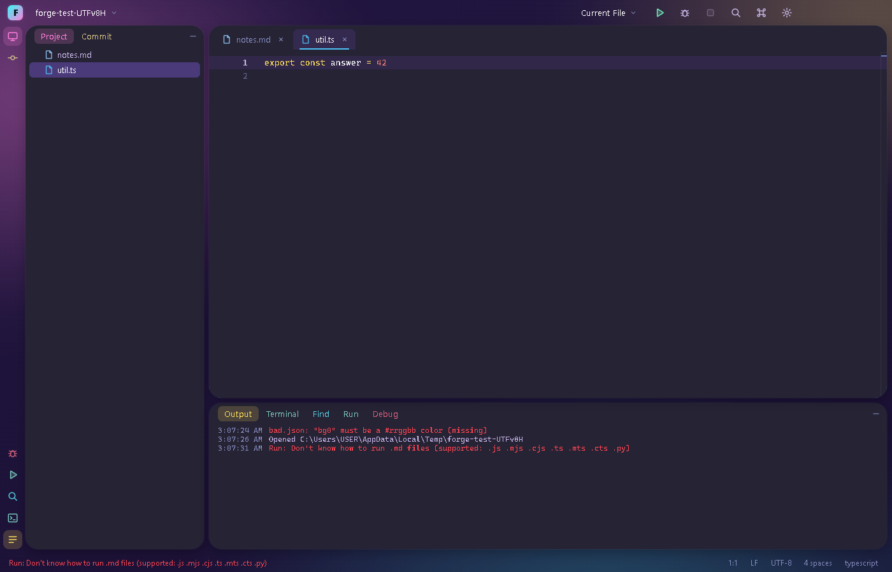
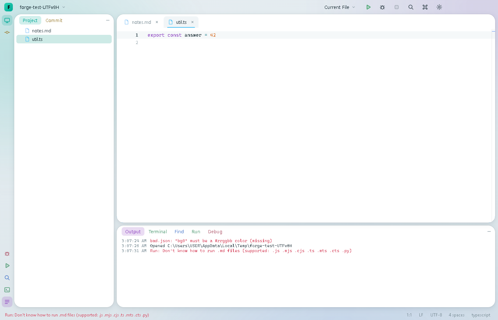
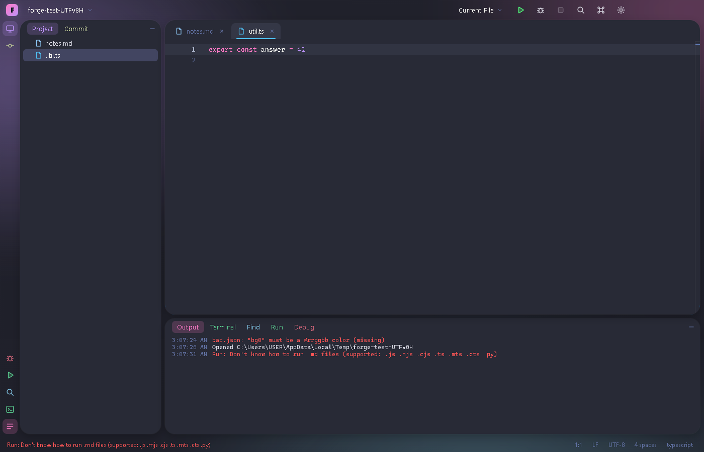
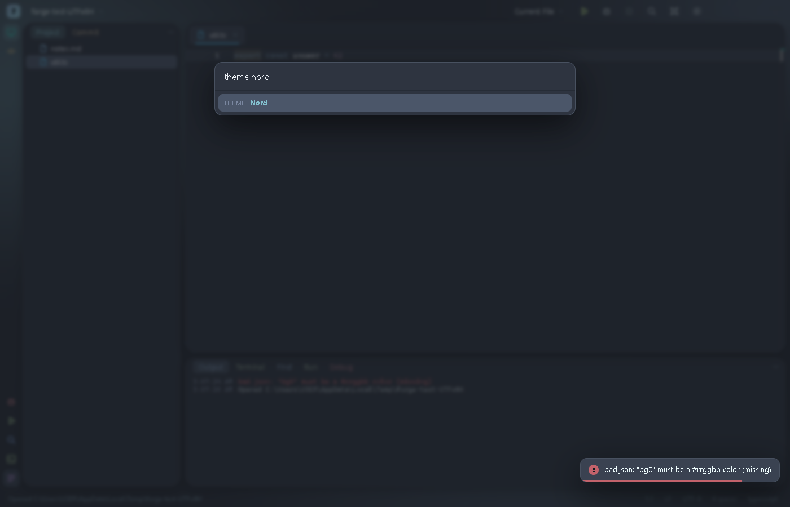

# Forge

A JetBrains-style IDE built with Electron, TypeScript and Monaco. It is a learning/portfolio project: the goal is a
fast, good-looking editor with real language intelligence, git, a terminal and a debugger, built in verified steps
with an end-to-end test suite that drives the real UI.



## Highlights

- **Colorful, animated, and yours to change** — 17 themes (dark, light and neon), a rainbow accent, glass panels, an
  animated aurora background, and about 50 settings that apply live. See [Make it yours](#make-it-yours).
- **A real IDE layout** — tool windows dock left, right or bottom and can be moved by menu or drag; Structure and
  Problems windows, breadcrumbs, a Project tree with locate/collapse, draggable tabs, styled tooltips and clickable
  status-bar widgets (go to line, line endings, indentation, language).
- **Real language intelligence** — completion, hover, go-to-definition, diagnostics, rename, find usages, formatting
  and quick fixes for TypeScript/JavaScript, Python, C/C++ and [Mort](https://github.com/0xmortuex/Mort), through
  language servers.
- **Git without leaving the editor** — a Git window with a commit graph, branches, merge/rebase/cherry-pick/revert,
  a merge-conflict resolver, gutter change markers with rollback, commit window with per-file selection, editable
  side-by-side diffs, blame, stash and tags.
- **Run and debug** — run configurations (with a GUI editor), test run arrows, and a debugger for Node and Python
  with conditional breakpoints, logpoints, watches, stepping, call stack and expression evaluation.
- **Navigation and tooling** — recent files/locations, back/forward, bookmarks, call and type hierarchy, inlay
  hints, find/replace in files, local history, scratch files, live templates, split editor, Markdown preview, a
  built-in HTTP client for `.http` files, EditorConfig and a TODO window.
- **Extensible** — a small, documented extension API (off by default), plus drop-in theme files.

## Features

| | |
| --- | --- |
| **Layout** | Left, right and bottom docks with a stripe on each edge; move any tool window between them (right-click its button, or drag it to another edge). Sizes and placement are remembered. |
| **Editor** | Monaco, tabs (reorder by dragging, middle-click to close), breadcrumbs, Structure window, Problems window, project tree (create / rename / delete to the Recycle Bin), Search Everywhere (double-<kbd>Shift</kbd>), project-wide search, Zen mode, full screen, session restore with recent projects. |
| **Languages** | TypeScript/JavaScript (`typescript-language-server`) and Python (`pyright`) are bundled. C/C++ uses `clangd` if it is on your `PATH`. Mort uses its own `mortc lsp`. Find usages, rename, reformat, quick fixes, format on save. |
| **Terminal** | Real shells (node-pty + xterm.js), as many as you like, in renamable tabs; choose PowerShell, cmd, Git Bash or WSL in Settings. |
| **Git** | Branch widget with ahead/behind, Git window (graph log, commit details, branches), Commit window with amend, editable diffs, gutter hunks with rollback, blame, merge conflicts with Accept Yours/Theirs, file history, colored tree, push (publishes new branches, force-with-lease), pull (merge, rebase or fast-forward), stash, revert, reset, tags. Uses the `git` CLI. |
| **Search & refactor** | Find/Replace in the file and in the project (case, whole word, regex, file mask), rename with import updates when files are renamed or moved, find usages, go to implementation / type definition, call and type hierarchy, TODO window, and Inspect Code (runs `tsc` and ESLint over the whole project into the Problems window). |
| **Run & debug** | `.forge/run.json` configurations (Node, Python, shell commands, or the current file) with a dialog to edit them, run arrows next to Vitest/Jest/node:test/pytest tests, a Run tab with a real terminal, Node debugger (V8 inspector) and Python debugger (`debugpy`, over DAP) with conditional breakpoints, logpoints and watches. |
| **Customization** | Themes, accent, fonts, layout density, panel shape, motion, editor and terminal options, custom shortcuts, command palette. |









## Make it yours

Open **Settings** with <kbd>Ctrl</kbd>+<kbd>,</kbd>, or press <kbd>Ctrl</kbd>+<kbd>Shift</kbd>+<kbd>P</kbd> for the
**Command Palette**, which runs every action and previews themes live as you move through the list.



- **Themes** — Material Oceanic, Darcula, Dracula, Nord, Tokyo Night, Monokai Pro, Solarized (dark and light),
  Gruvbox, Catppuccin, Rosé Pine, One Dark, GitHub (dark and light), Synthwave '84, Forge Light, High Contrast. One
  small palette drives the interface, the editor's syntax colors and the terminal. Add your own as a JSON file.
  They can follow your system's light/dark setting (pick one theme for each).
- **Accent** — twelve swatches, any custom color, or a slowly cycling rainbow.
- **Fonts** — JetBrains Mono, Fira Code (with ligatures) and Inter are bundled, so it looks the same on any machine.
- **Custom CSS** — restyle anything with your own `custom.css`; it applies live when you save it, and there is an off
  switch in case a style breaks the layout.
- **Motion** — panels slide, tabs pop in, folders fade open, notifications slide in, buttons ripple; choose *Full*,
  *Reduced* or *Off*, and a speed.
- **Layout** — corner radius, panel spacing, density, interface font and size, zoom, status bar and tool-window
  buttons on or off.
- **Editor / Terminal** — fonts, ligatures, minimap, rulers, word wrap, whitespace, line numbers, cursor style,
  rainbow brackets, sticky scroll, auto save, format on save, scrollback and more.
- **Keymap** — set your own shortcut for any command (it is added to the default).
- **Extensions** — see [docs/EXTENSIONS.md](docs/EXTENSIONS.md).

<table>
  <tr>
    <td></td>
    <td></td>
  </tr>
  <tr>
    <td></td>
    <td></td>
  </tr>
</table>

Settings live in `settings.json` in Forge's user-data folder (**Settings → Open settings.json**). If you edit it by
hand and make a mistake, Forge tells you, starts with defaults, and keeps your file as `settings.json.broken`
instead of overwriting it.

## Keyboard shortcuts

| Action | Keys |
| --- | --- |
| Command Palette / Settings | <kbd>Ctrl</kbd>+<kbd>Shift</kbd>+<kbd>P</kbd> or <kbd>F1</kbd> / <kbd>Ctrl</kbd>+<kbd>,</kbd> |
| Open folder / Save / Close tab | <kbd>Ctrl</kbd>+<kbd>O</kbd> / <kbd>Ctrl</kbd>+<kbd>S</kbd> / <kbd>Ctrl</kbd>+<kbd>W</kbd> |
| Search Everywhere / Find in project | <kbd>Shift</kbd> <kbd>Shift</kbd> / <kbd>Ctrl</kbd>+<kbd>Shift</kbd>+<kbd>F</kbd> |
| Project / Commit / Output / Terminal | <kbd>Alt</kbd>+<kbd>1</kbd> / <kbd>0</kbd> / <kbd>2</kbd> / <kbd>3</kbd> |
| Problems / Structure | <kbd>Alt</kbd>+<kbd>6</kbd> / <kbd>7</kbd> |
| Go to symbol in file / Go to line | <kbd>Ctrl</kbd>+<kbd>Shift</kbd>+<kbd>O</kbd> / <kbd>Ctrl</kbd>+<kbd>G</kbd> |
| New terminal | <kbd>Ctrl</kbd>+<kbd>Shift</kbd>+<kbd>`</kbd> |
| Zen mode / Full screen | <kbd>Ctrl</kbd>+<kbd>Alt</kbd>+<kbd>Z</kbd> / <kbd>F11</kbd> |
| Rename / Find usages / Reformat / Quick fix | <kbd>F2</kbd> / <kbd>Alt</kbd>+<kbd>F7</kbd> / <kbd>Ctrl</kbd>+<kbd>Alt</kbd>+<kbd>L</kbd> / <kbd>Ctrl</kbd>+<kbd>.</kbd> |
| Run / Debug / Stop | <kbd>Shift</kbd>+<kbd>F10</kbd> / <kbd>Shift</kbd>+<kbd>F9</kbd> / <kbd>Ctrl</kbd>+<kbd>F2</kbd> |
| Resume / Step over / Step into / Step out | <kbd>F9</kbd> / <kbd>F8</kbd> / <kbd>F7</kbd> / <kbd>Shift</kbd>+<kbd>F8</kbd> |
| Toggle breakpoint | <kbd>Ctrl</kbd>+<kbd>F8</kbd> or click the gutter |
| Recent files / Recent locations | <kbd>Ctrl</kbd>+<kbd>E</kbd> / <kbd>Ctrl</kbd>+<kbd>Shift</kbd>+<kbd>E</kbd> |
| Back / Forward | <kbd>Ctrl</kbd>+<kbd>Alt</kbd>+<kbd>←</kbd> / <kbd>→</kbd> |
| Next / previous tab | <kbd>Ctrl</kbd>+<kbd>Tab</kbd> / <kbd>Ctrl</kbd>+<kbd>Shift</kbd>+<kbd>Tab</kbd> |
| Replace in file / Replace in project | <kbd>Ctrl</kbd>+<kbd>H</kbd> / <kbd>Ctrl</kbd>+<kbd>Shift</kbd>+<kbd>R</kbd> |
| Go to implementation / Find usages | <kbd>Ctrl</kbd>+<kbd>Alt</kbd>+<kbd>B</kbd> / <kbd>Alt</kbd>+<kbd>F7</kbd> |
| Toggle bookmark / Show bookmarks | <kbd>Ctrl</kbd>+<kbd>F11</kbd> / <kbd>Shift</kbd>+<kbd>F11</kbd> |
| Next / previous change | <kbd>Ctrl</kbd>+<kbd>Alt</kbd>+<kbd>Shift</kbd>+<kbd>↓</kbd> / <kbd>↑</kbd> |
| Run HTTP request (in a `.http` file) | <kbd>Ctrl</kbd>+<kbd>Enter</kbd> |

## Getting started

Requires Node 20+ and [pnpm](https://pnpm.io). Windows is the primary target (it is developed and tested there).

```sh
pnpm install
pnpm dev        # run in development
pnpm build      # production build into out/
pnpm test       # build, then run the end-to-end scenarios
```

A run configuration file looks like this (the run widget → *Edit Configurations…* creates a template):

```json
{
  "configurations": [
    { "name": "Current File", "type": "current-file" },
    { "name": "Run script", "type": "node", "program": "index.js", "args": [] },
    { "name": "Dev server", "type": "command", "command": "pnpm dev" }
  ]
}
```

Python debugging needs `debugpy` (`uv pip install debugpy`). Mort support needs `mortc` on your `PATH`, or the
`MORTC` environment variable pointing at your `mortc.py`.

## How it is built

- `src/main` — Electron main process: filesystem, node-pty terminals, language-server processes, git, the debug
  backends (a Node adapter over the V8 inspector, and a DAP client for Python's debugpy), user settings and
  extension loading.
- `src/preload` — the small, typed bridge exposed to the renderer.
- `src/renderer` — the UI (vanilla TypeScript, no framework). Every color is a CSS variable derived from the active
  theme; every setting is declared once in `settings.ts`, from which the Settings window is generated.
- `tests/` — end-to-end scenarios. Each boots the built app against a temporary project and a throwaway user-data
  folder, sends real key and mouse events, and asserts on the DOM and the filesystem (`pnpm test`).
- `docs/` — [extension guide](docs/EXTENSIONS.md); `examples/` — a working example extension.

## Known limitations

- Windows is the only platform it has actually been run on. CI type-checks and builds on Windows, Linux and macOS,
  and the code has macOS/Linux branches, but they are untested.
- There is no packaged installer yet; run it from source.
- Debugging covers Node and Python only.
- The split editor (two panes) has Monaco's built-in features but not Forge's refactor actions; Problems lists the open files only, not the whole project.
- Inspect Code runs `tsc` and ESLint only; there is no Python or C++ project-wide analysis.
- Markdown preview does not load remote images (the content security policy blocks them).
- The pytest runner and the `clangd` integration have not been exercised end to end.
- The built-in IDE shortcuts (Alt+digit, F-keys, Ctrl+Shift+P …) work inside the terminal; your own custom shortcuts do not.
- The extension API is deliberately small (version 1).

## License

MIT
