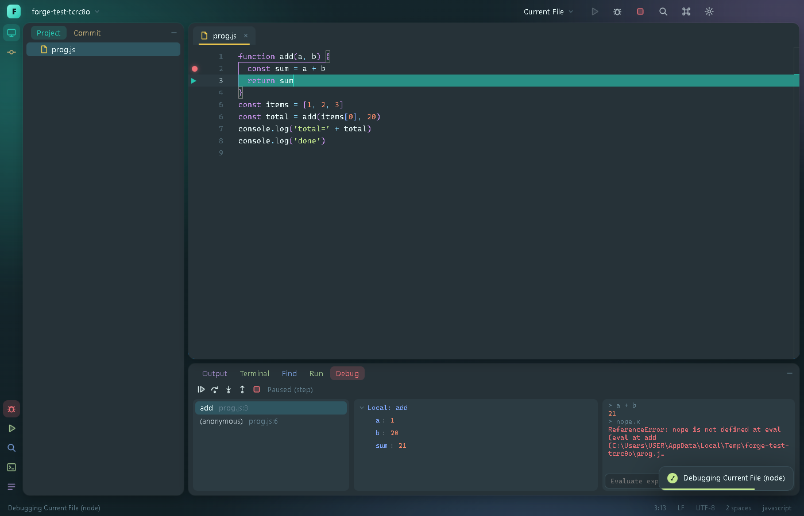

# Forge

A JetBrains-style IDE built with Electron, TypeScript and Monaco. It is a learning/portfolio project: the goal is a
fast, good-looking editor with real language intelligence, git, a terminal and a debugger, built in verified steps
with an end-to-end test suite that drives the real UI.



## Highlights

- **Colorful, animated, and yours to change** — 17 themes (dark, light and neon), a rainbow accent, glass panels, an
  animated aurora background, and about 50 settings that apply live. See [Make it yours](#make-it-yours).
- **Real language intelligence** — completion, hover, go-to-definition, diagnostics, rename, find usages, formatting
  and quick fixes for TypeScript/JavaScript, Python, C/C++ and [Mort](https://github.com/0xmortuex/Mort), through
  language servers.
- **Git without leaving the editor** — commit window with per-file selection, editable side-by-side diffs, blame,
  branches, push/pull/stash/revert.
- **Run and debug** — run configurations, and a debugger for Node and Python with breakpoints, stepping, call
  stack, variables and expression evaluation.
- **Extensible** — a small, documented extension API (off by default), plus drop-in theme files.

## Features

| | |
| --- | --- |
| **Editor** | Monaco, tabs, project tree (create / rename / delete to the Recycle Bin), Search Everywhere (double-<kbd>Shift</kbd>), project-wide search, Zen mode, full screen, session restore with recent projects. |
| **Languages** | TypeScript/JavaScript (`typescript-language-server`) and Python (`pyright`) are bundled. C/C++ uses `clangd` if it is on your `PATH`. Mort uses its own `mortc lsp`. Find usages, rename, reformat, quick fixes, format on save. |
| **Terminal** | Real shells (node-pty + xterm.js), as many as you like, in tabs. |
| **Git** | Branch widget with ahead/behind, Commit window, editable diffs, blame in the status bar, colored tree, push (publishes new branches), fast-forward pull, stash (with untracked files), revert. Uses the `git` CLI. |
| **Run & debug** | `.forge/run.json` configurations (Node, Python, shell commands, or the current file), a Run tab with a real terminal, Node debugger (V8 inspector) and Python debugger (`debugpy`, over DAP). |
| **Customization** | Themes, accent, fonts, layout density, panel shape, motion, editor and terminal options, custom shortcuts, command palette. |


## Make it yours

Open **Settings** with <kbd>Ctrl</kbd>+<kbd>,</kbd>, or press <kbd>Ctrl</kbd>+<kbd>Shift</kbd>+<kbd>P</kbd> for the
**Command Palette**, which runs every action and previews themes live as you move through the list.


- **Themes** — Material Oceanic, Darcula, Dracula, Nord, Tokyo Night, Monokai Pro, Solarized (dark and light),
  Gruvbox, Catppuccin, Rosé Pine, One Dark, GitHub (dark and light), Synthwave '84, Forge Light, High Contrast. One
  small palette drives the interface, the editor's syntax colors and the terminal. Add your own as a JSON file.
- **Accent** — twelve swatches, any custom color, or a slowly cycling rainbow.
- **Motion** — panels slide, tabs pop in, folders fade open, notifications slide in, buttons ripple; choose *Full*,
  *Reduced* or *Off*, and a speed.
- **Layout** — corner radius, panel spacing, density, interface font and size, zoom, status bar and tool-window
  buttons on or off.
- **Editor / Terminal** — fonts, ligatures, minimap, rulers, word wrap, whitespace, line numbers, cursor style,
  rainbow brackets, sticky scroll, auto save, format on save, scrollback and more.
- **Keymap** — set your own shortcut for any command (it is added to the default).
- **Extensions** — see [docs/EXTENSIONS.md](docs/EXTENSIONS.md).

<table>
  <tr>
    <td></td>
    <td></td>
  </tr>
  <tr>
    <td></td>
    <td></td>
  </tr>
</table>

Settings live in `settings.json` in Forge's user-data folder (**Settings → Open settings.json**). If you edit it by
hand and make a mistake, Forge tells you, starts with defaults, and keeps your file as `settings.json.broken`
instead of overwriting it.

## Keyboard shortcuts

| Action | Keys |
| --- | --- |
| Command Palette / Settings | <kbd>Ctrl</kbd>+<kbd>Shift</kbd>+<kbd>P</kbd> or <kbd>F1</kbd> / <kbd>Ctrl</kbd>+<kbd>,</kbd> |
| Open folder / Save / Close tab | <kbd>Ctrl</kbd>+<kbd>O</kbd> / <kbd>Ctrl</kbd>+<kbd>S</kbd> / <kbd>Ctrl</kbd>+<kbd>W</kbd> |
| Search Everywhere / Find in project | <kbd>Shift</kbd> <kbd>Shift</kbd> / <kbd>Ctrl</kbd>+<kbd>Shift</kbd>+<kbd>F</kbd> |
| Project / Commit / Output / Terminal | <kbd>Alt</kbd>+<kbd>1</kbd> / <kbd>0</kbd> / <kbd>2</kbd> / <kbd>3</kbd> |
| New terminal | <kbd>Ctrl</kbd>+<kbd>Shift</kbd>+<kbd>`</kbd> |
| Zen mode / Full screen | <kbd>Ctrl</kbd>+<kbd>Alt</kbd>+<kbd>Z</kbd> / <kbd>F11</kbd> |
| Rename / Find usages / Reformat / Quick fix | <kbd>F2</kbd> / <kbd>Alt</kbd>+<kbd>F7</kbd> / <kbd>Ctrl</kbd>+<kbd>Alt</kbd>+<kbd>L</kbd> / <kbd>Ctrl</kbd>+<kbd>.</kbd> |
| Run / Debug / Stop | <kbd>Shift</kbd>+<kbd>F10</kbd> / <kbd>Shift</kbd>+<kbd>F9</kbd> / <kbd>Ctrl</kbd>+<kbd>F2</kbd> |
| Resume / Step over / Step into / Step out | <kbd>F9</kbd> / <kbd>F8</kbd> / <kbd>F7</kbd> / <kbd>Shift</kbd>+<kbd>F8</kbd> |
| Toggle breakpoint | <kbd>Ctrl</kbd>+<kbd>F8</kbd> or click the gutter |

## Getting started

Requires Node 20+ and [pnpm](https://pnpm.io). Windows is the primary target (it is developed and tested there).

```sh
pnpm install
pnpm dev        # run in development
pnpm build      # production build into out/
pnpm test       # build, then run the end-to-end scenarios
```

A run configuration file looks like this (the run widget → *Edit Configurations…* creates a template):

```json
{
  "configurations": [
    { "name": "Current File", "type": "current-file" },
    { "name": "Run script", "type": "node", "program": "index.js", "args": [] },
    { "name": "Dev server", "type": "command", "command": "pnpm dev" }
  ]
}
```

Python debugging needs `debugpy` (`uv pip install debugpy`). Mort support needs `mortc` on your `PATH`, or the
`MORTC` environment variable pointing at your `mortc.py`.

## How it is built

- `src/main` — Electron main process: filesystem, node-pty terminals, language-server processes, git, the debug
  backends (a Node adapter over the V8 inspector, and a DAP client for Python's debugpy), user settings and
  extension loading.
- `src/preload` — the small, typed bridge exposed to the renderer.
- `src/renderer` — the UI (vanilla TypeScript, no framework). Every color is a CSS variable derived from the active
  theme; every setting is declared once in `settings.ts`, from which the Settings window is generated.
- `tests/` — end-to-end scenarios. Each boots the built app against a temporary project and a throwaway user-data
  folder, sends real key and mouse events, and asserts on the DOM and the filesystem (`pnpm test`).
- `docs/` — [extension guide](docs/EXTENSIONS.md); `examples/` — a working example extension.

## Known limitations

- Windows is the only platform it has actually been run on. CI type-checks and builds on Windows, Linux and macOS,
  and the code has macOS/Linux branches, but they are untested.
- There is no packaged installer yet; run it from source.
- Debugging covers Node and Python only (no conditional breakpoints or logpoints yet).
- Git has no history viewer, merge-conflict UI or branch deletion; pull is fast-forward only.
- One editor group (no split editors). The extension API is deliberately small (version 1).

## License

MIT
